Full-stack engineer, 13 years in production: React, Next.js, TypeScript, Node.js, PostgreSQL.

Most of my work lives in private repositories, so there is little public code here.

**[prmpt.bio](https://prmpt.bio)**: a generative media platform I designed, built and launched. 60 image and video models behind one interface, a double-entry credit ledger, C2PA on every output. How it works: [okandship.com/prmptbio](https://okandship.com/prmptbio/)

**Before**: Taplio at lemlist, in Next.js and Node.js. Eleven years at Webcloud as technical lead.

[matteo@okandship.com](mailto:matteo@okandship.com) · [linkedin.com/in/okandship](https://www.linkedin.com/in/okandship/)
